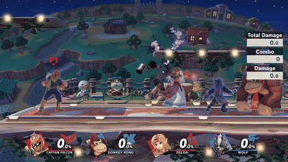
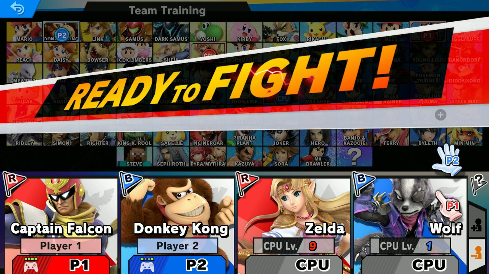
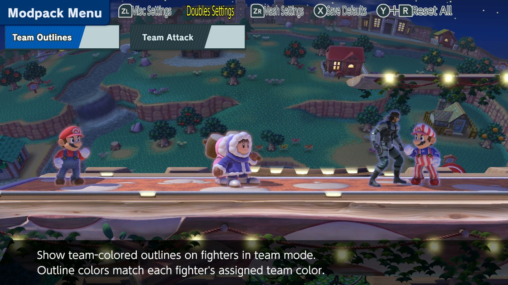
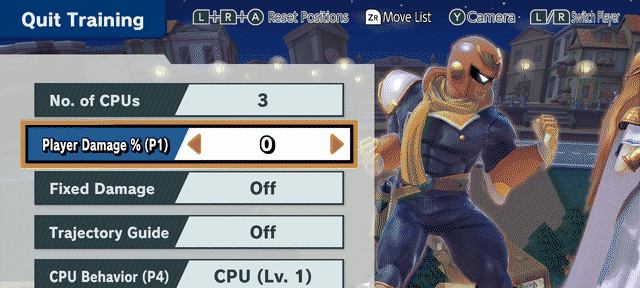
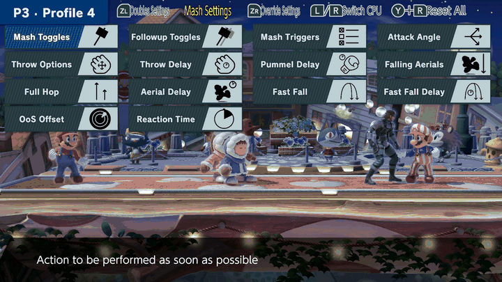

# Doubles Training Modpack

A fork of the [Ultimate Training Modpack](https://github.com/jugeeya/UltimateTrainingModpack) that turns Smash
Ultimate's Training mode into a doubles lab: up to 4 humans and up to 3 CPUs.
Credit to jugeeya and other contributors, who made the menus,
save states and CPU options this mod builds on.

Download the **[latest release here](https://github.com/sbergeron42/DoublesTrainingModpack/releases/latest).**

<p align="center">

</p>

<p align="center"><i>Practice and lab sick dubs combos/setups with a buddy!</i></p>

<a name="doubles-features"/>

#  Features

## Team Training CSS
<p align="center">

</p>

<p align="center"><i>`X` to toggle between Training and Team Training. UI works like in Smash mode's Team Battle.</i></p>

## Dubs Settings and Mechanics

<p align="center">

</p>

- **Doubles-specific mechanics:** Teammates can't footstool each other and have different jostle values.
- **Team Attack** and **Team Outlines** are on by default and can be turned off in the modpack menu.
- **Persisted CPU difficulties:** a Lv. 9 Zelda and a Lv. 1 Wolf play at Lv. 9 and Lv. 1.

## Enhanced Vanilla Training Menu

<p align="center">

</p>

- **Select a row and tap `L` / `R` to switch Player.**
  - **Player Damage %** sets P1 to P4. It replaces CPU Damage % and P1 Damage % in vanilla Ultimate.
  - **CPU Behavior** sets per CPU: 'Stop', 'Walk', 'Lvl (n)', etc.

## CPU Profiles

<p align="center">

</p>

<p align="center"><i>Up to the title, then Left / Right to change profile.
<code>L</code> / <code>R</code> switch CPU (<code>Y</code> + <code>L</code> / <code>R</code> on GameCube).</i></p>

Ability to set unique behavior for each CPU and in an easy way. Up to 8 profiles are available.

## Everything else from Ultimate Training Modpack

Everything from the Ultimate Training Modpack is included. Refer to their
[README](https://github.com/jugeeya/UltimateTrainingModpack#readme) for more info.

- **Mash, follow-up and defensive options**: triggers, aerial delay, fast fall, DI, SDI,
  air dodge, ledge, tech, shield and more.
- **Save states** (default `ZL` + `D-Pad Down` to save, `ZL` + `D-Pad Up` to load):
  - five slots, mirroring and randomized damage;
  - charge levels, buffs and character items.
- **Input recording** (`ZR` + `D-Pad Down` to record, `ZR` + `D-Pad Up` to play back), usable as a CPU option.
- **Misc:** hitbox visualization, frame advantage, input delay, stage hazards on/off, HUD toggle.
- **Menu use:** when several options are picked, one is chosen at random. `X` saves the current settings as your
  defaults.

<a name="compatibility"/>

<a name="build"/>

# Build

Needs nightly Rust (see `rust-toolchain.toml`) and [cargo-skyline](https://github.com/jam1garner/cargo-skyline).

```bash
cargo skyline build --release
```

- **Output:** `target/aarch64-skyline-switch/release/libdubs_training_modpack.nro`.
- **`doubles_debug_log`:** writes a log to `sd:/ultimate/TrainingModpack/doubles_debug.log`.
- **`doubles_ui_diagnostics`:** adds UI pane probes and also turns on the log. Can stall in emulators.

# Compatibility/Limitations

- **Tested on patch 13.0.5.**
- Incompatible with Jugeeya's Ultimate Training Modpack. (WIP)
- Some features haven't been tested/scaled to 4 players, like character items.
- Experimental/doubles-native features TBD, e.g. solo dubs practice (open to feedback!)
