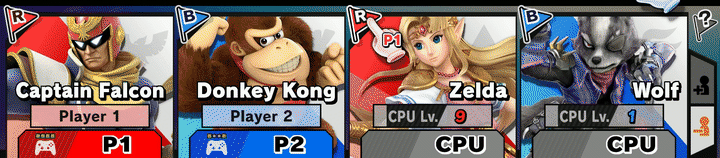
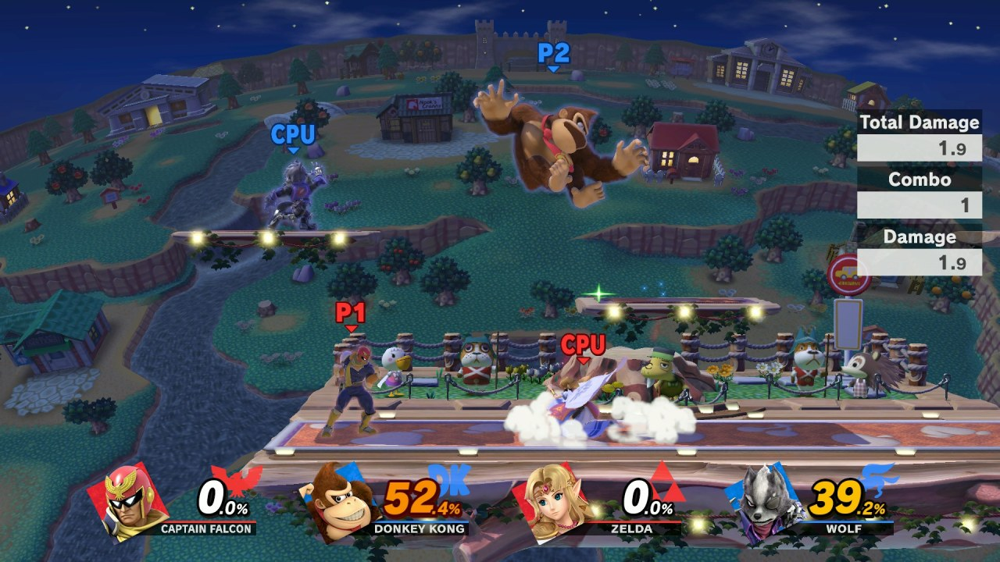
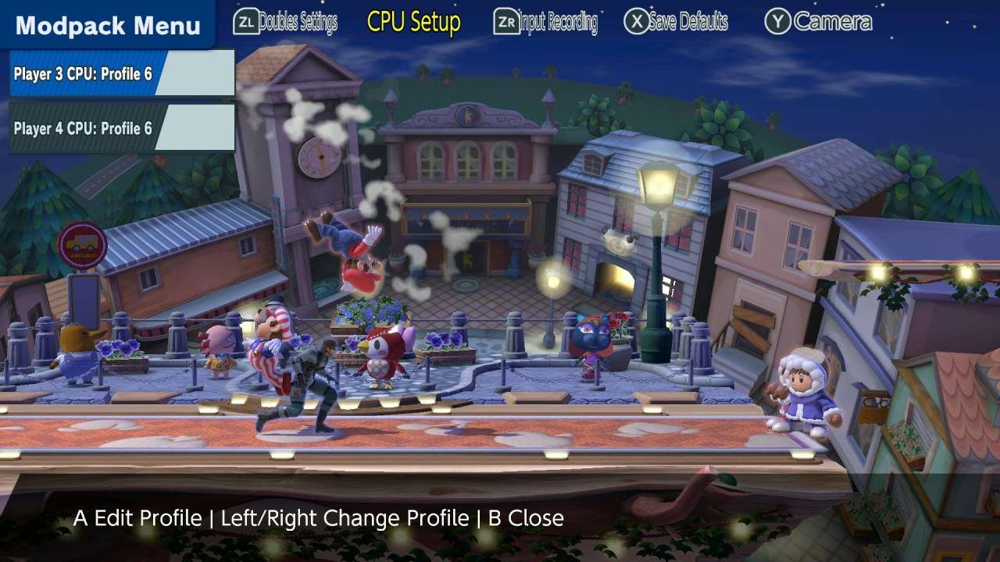

# Doubles Training Modpack

A fork of the [Ultimate Training Modpack](https://github.com/jugeeya/UltimateTrainingModpack) that turns Smash
Ultimate's Training mode into a doubles lab. Put up to four fighters on stage, in any mix of humans and CPUs,
split them into teams, and give every CPU its own settings.

**[Download the latest release](https://github.com/sbergeron42/DoublesTrainingModpack/releases/latest)**:
`libdubs_training_modpack.nro`, for Smash Ultimate 13.0.5. See [Installation](#installation).

<p align="center">

</p>

<p align="center"><i>A 2v2 in Training. Red: Captain Falcon (P1, human) and Zelda (CPU, Lv. 9). Blue: Donkey Kong
(P2, human) and Wolf (CPU, Lv. 1).</i></p>

- [Doubles features](#doubles-features)
- [Installation](#installation)
- [How to use it](#usage)
- [Compatibility and known limits](#compatibility)
- [Training Modpack features](#features)
- [Build from source](#build)
- [Credits](#credits)

<a name="doubles-features"/>

# Doubles features

## Four fighters, on teams


- **Four panels on the Training character select.** Fill P2, P3 and P4 with humans or CPUs, each with its own
  fighter, costume and CPU level.
- **Team Training.** Press `X` on the character select to switch between team mode ("Team Training") and the
  usual 1v1.
- **The game's own team flags.** Press `A` on a panel's flag to cycle its team (red, blue, green, yellow), as in
  Smash mode's Team Battle.

<p align="center">

</p>

- **Doubles in the match.** Every fighter spawns in its team's color: names, HUD, pointers and outlines.
  - CPUs fight each other as well as the humans.
  - Teammates don't push each other around and can't footstool each other.
- **Team Attack.** On by default, as in competitive doubles: teammates can hit each other. Turn it off in the
  modpack menu's Doubles Settings.
- **Each CPU plays at its own level.** A Lv. 9 Zelda and a Lv. 1 Wolf really play at Lv. 9 and Lv. 1.
- **Every human on their own controller.** P2 (and P3 or P4) use whichever controller picked them on character
  select.



## Every fighter set up on its own

The Training menu (`+`) edits one fighter at a time. Select the row and tap `L` / `R` to switch fighter. The
row title says whose value you're editing, and the top bar shows the hint.

- **Player Damage %**: every fighter's damage, P1 to P4, humans included. It replaces CPU Damage % on the main
  page, and P1 Damage % under Other Settings.
- **CPU Behavior**: each CPU's behavior (Stop, Walk, Jump, CPU (Lv. n), Control, ...). "CPU (Lv. n)" uses that
  CPU's own level from character select.

<p align="center">

</p>

The modpack menu (hold `D-Pad Up` and press `B`, or hold `Start`) adds two pages:

| CPU Setup | Doubles Settings |
|:---:|:---:|
|  |  |
| Give each CPU slot its own **profile**: its mash, DI, ledge, tech, shield options and more. `Left` / `Right` changes the profile, `A` edits it. | **Team Outlines** and **Team Attack**. |

- **Mixups follow the hit.** DI, SDI and hitstun airdodge In/Out follow the direction a fighter is launched,
  whoever hit it.
- **Distance triggers measure to the nearest opponent.** Close, Mid and Far use the closest fighter on the
  other team, not P1.
- **Ice Climbers.** Popo and Nana each keep one DI pick per hit.

<a name="installation"/>

# Installation

You need a Switch running [Atmosphere](https://github.com/Atmosphere-NX/Atmosphere/releases) and
[Skyline](https://github.com/skyline-dev/skyline/releases), the same setup as the regular Training Modpack.

1. Install Skyline: put its `exefs` folder in `sd:/atmosphere/contents/01006A800016E000/`.
2. Put these plugins in `sd:/atmosphere/contents/01006A800016E000/romfs/skyline/plugins/`:
   - `libdubs_training_modpack.nro`, from [this repo's releases](https://github.com/sbergeron42/DoublesTrainingModpack/releases/latest);
   - `libnro_hook.nro` ([nro-hook-plugin](https://github.com/ultimate-research/nro-hook-plugin/releases)) and
     `libparam_hook.nro` ([params-hook-plugin](https://github.com/ultimate-research/params-hook-plugin/releases)).
     If you already run the Training Modpack, you have these.
3. **Remove `libtraining_modpack.nro`** if it's there. This mod replaces the regular Training Modpack; running
   both at once isn't supported.

```
SD Card Root
└── atmosphere/
    └── contents/
        └── 01006A800016E000/
            ├── exefs/
            │   ├── subsdk9
            │   └── main.npdm
            └── romfs/
                └── skyline/
                    └── plugins/
                        ├── libdubs_training_modpack.nro
                        ├── libnro_hook.nro
                        └── libparam_hook.nro
```

Settings are saved to `sd:/ultimate/TrainingModpack/training_modpack_dubs.conf`, separately from the regular
Training Modpack's.

<a name="usage"/>

# How to use it

1. **Character select.** Open Training. Press `X` for Team Training.
   - Add CPUs with a panel's type button at the bottom (None → CPU), or join with more controllers for humans.
   - Pick fighters and CPU levels.
   - Press `A` on a flag to change that panel's team.
2. **Start.** Every fighter spawns on its team. CPUs start on Stop, as in vanilla Training.
3. **Training menu (`+`).** Set **CPU Behavior** to "CPU (Lv. n)" to let the CPUs fight. Tap `L` / `R` on the row
   to give each CPU its own behavior, and use **Player Damage %** the same way.
4. **Modpack menu.** Open it with `D-Pad Up` + `B`, or hold `Start`. **CPU Setup** gives each CPU its own profile
   (mash, DI, ledge, ...); **Doubles Settings** has Team Outlines and Team Attack. All the regular Training
   Modpack pages are there too.

<a name="compatibility"/>

# Compatibility and known limits

- **Smash Ultimate 13.0.5**, the current version, is what this release is tested on. The mod also carries the
  addresses for 13.0.4, but recent features weren't tested there.
- **Each CPU's behavior and every fighter's damage** reset to the menu's values at the start of each Training
  session.
- **Hitbox Visualization** hides other move effects while it's on, as in the regular Training Modpack. They
  come back when you turn it off.

<a name="features"/>

# Training Modpack features

Everything from the Ultimate Training Modpack is here: save states, mash and defensive options, input
recording, hitbox visualization and more. The reference below is the Training Modpack's, and its
[README](https://github.com/jugeeya/UltimateTrainingModpack#readme) has the full FAQ. In this fork, mash and
defensive options are set per CPU through profiles (CPU Setup, above).

## Menu Settings

When multiple options are selected, one of the selected options will be chosen at random. Open / focused menus can be reset by pressing the `Y` button. All menus can be reset to the default by pressing the `Z`/`ZR` button. These defaults can be saved upon exiting the menu by pressing `X` when in-menu. Use this to make a preset that fits your personal training style.

### Mash Settings


<p align="center"><sub><i>Picture courtesy of the <a href="https://github.com/jugeeya/UltimateTrainingModpack">Ultimate Training Modpack</a>.</i></sub></p>
<details><summary>Click here for setting descriptions...</summary>

| Feature | Description | Options |
|:---:|:---|:---|
| Mash Toggles | Actions to be performed as soon as possible out of hitstun or shieldstun | Airdodge, jump, shield, spotdodge, roll in, roll out, aerials, jab, tilts, smash attacks, grab, dash, dash attack |
| Followup Toggles | Actions to be performed after the Mash option | Airdodge, jump, shield, spotdodge, roll in, roll out, aerials, jab, tilts, smash attacks, grab, dash, dash attack |
| Mash Triggers | Conditions which will cause the CPU to perform their mash action | Hitstun, shieldstun, parry, tumble, landing, ledge trump, footstool, clatter, ledge option, tech option, grounded, airborne, distance: close, distance: mid, distance: far, always |
| Attack Angles | For attacks that can be angled, such as some forward tilts | Neutral, up, down |
| Throw Options | Throw to be performed when a grab is landed | None, Forward Throw, Back Throw, Up Throw, Down Throw |
| Throw Delay | How many frames to delay the throw option | 0 to 150 frames (2.5 seconds) in increments of 5 frames |
| Pummel Delay | How many frames after a grab to wait before starting to pummel | 0 to 150 frames (2.5 seconds) in increments of 5 frames |
| Falling Aerials | Should aerials be performed when rising or when falling | Yes, No |
| Full Hop | Should the CPU perform a full hop or a short hop | Yes, No |
| Aerial Delay | How long to delay a Mash aerial attack | 0 to 30 frames (0.5 seconds) |
| Fast Fall | Should the CPU fastfall during a jump | Yes, No |
| Fast Fall Delay | How many frames the CPU should delay their fastfall | 0 to 30 frames (0.5 seconds) |
| OoS Offset | How many times the CPU shield can be hit before performing a Mash option | 0 to 30 hits |
| Reaction Time | How many frames to delay before performing an option out of shield | 0 to 30 frames (0.5 seconds) |


</details>

### Defensive Settings

<p align="center"><sub><i>Picture courtesy of the <a href="https://github.com/jugeeya/UltimateTrainingModpack">Ultimate Training Modpack</a>.</i></sub></p>
<details><summary>Click here for setting descriptions...</summary>

| Feature | Description | Options |
|:---:|:---|:---|
| Airdodge Direction | Direction to angle airdodges | Neutral, out, up-out, up, up-in, in, down-in, down, down-out, left, right |
| DI Direction | Direction to angle the directional influence during hitlag | Neutral, out, up-out, up, up-in, in, down-in, down, down-out, left, right |
| SDI Direction | Direction to angle the smash directional influence during hitlag | Neutral, out, up-out, up, up-in, in, down-in, down, down-out, left, right |
| SDI Strength | Relative strength of the smash directional influence inputs | None, Normal (8 frames between inputs), Medium (6 frames), High (4 frames) |
| Clatter Strength | Relative strength of mashing out of grabs, buries, etc. | None, Normal (8 frames between inputs), Medium (6 frames), High (4 frames) |
| Ledge Options | Actions to be taken when on the ledge | Neutral getup, ledge roll, ledge attack, wait |
| Ledge Delay | How many frames to delay the ledge option | 0 to 300 frames (5 seconds) in increments of 10 frames |
| Tech Options | Actions to take when slammed into a hard surface | Miss tech, tech in place, tech roll in, tech roll out |
| Mistech Options | Actions to take after missing a tech | Neutral getup, getup attack, roll in, roll out |
| Shield Toggles | CPU Shield Behavior | None, Infinite (no shield damage or decay), Hold (no shield decay until the shield is hit for the first time), Constant (no shield decay) |
| Shield Tilt | Direction to tilt the shield | Neutral, out, up-out, up, up-in, in, down-in, down, down-out, left, right |
| Crouch | Should the CPU crouch when on the ground | Yes, No |

</details>


The CPU can be instructed to perform a wide array of different actions in response to particular situations. The following situations are available:

- Mash: To be performed after being hit or shielding an attack
- Followup: To be performed as soon as possible after the mash option
- Ledge: To be performed when hanging on the ledge
- Tech: To be performed when slammed into the ground or wall
- Miss Tech: To be performed after failing to tech
- Hitstun
- Shieldstun
- Parry
- Tumble
- Landing
- Ledge Trump
- Footstool
- Clatter ("Mashing out" of grabs, freeze, bury, etc.)
- Ledge Option
- Tech Option
- Grounded
- Airborne
- Distance: Close
- Distance: Mid
- Distance: Far
- Always

The timing of the CPU option can be influenced by the following settings:

- Mash Triggers
- Aerial Delay
- Ledge Delay
- OoS Offset
- Reaction Time
- Fast Fall Delay
- Falling Aerials


<p align="center"><sub><i>Picture courtesy of the <a href="https://github.com/jugeeya/UltimateTrainingModpack">Ultimate Training Modpack</a>.</i></sub></p>


### Save State Settings


<p align="center"><sub><i>Picture courtesy of the <a href="https://github.com/jugeeya/UltimateTrainingModpack">Ultimate Training Modpack</a>.</i></sub></p>

<p align="center">


</p>
<p align="center"><sub><i>Pictures courtesy of the <a href="https://github.com/jugeeya/UltimateTrainingModpack">Ultimate Training Modpack</a>.</i></sub></p>
<details><summary>Click here for setting descriptions...</summary>

| Feature | Description | Options |
| :---: | :--- | :--- |
| Mirroring | Flips save states in the left-right direction across the stage center | None, Alternate, Random |
| Save Damage | Should save states retain player/CPU damage | Yes, No |
| Save States Autoload | Load save state when any fighter dies | Yes, No |
| Save Damage (CPU) | What to use for CPU's damage on save state load | Default, Save State, Random |
| Damage Range (CPU) | Random percentage for save state load for CPU | 0 to 150 % |
| Save Damage (Player) | What to use for player's damage on save state load | Default, Save State, Random |
| Damage Range (Player) | Random percentage for save state load for player | 0 to 150 % |
| Enable Save States | Should save states be enabled or disabled | Yes, No |
| Save State Slot | Save and load states from different slots | 1, 2, 3, 4, 5 |
| Save State Random Slot | Load from a random slot | Yes, No |
| Character Item | The item to give to the player's fighter when loading a save state | None, Player item (#1 - #8), CPU item (#1 - #8) |
| Buff Options | Buff(s) to be applied to respective character when loading save states | Accelerate, Oomph, Psyche Up, Bounce, Arsene, Deep Breathing, Limit, K.O. Punch, Wing |

</details>

#### Save States

At any time in Training Mode, you can press `Shield + Down Taunt` to save the state of training mode. This will save the position, state, and damage of each fighter, which can then be reverted to at any time with `Shield + Up Taunt`. With the mirroring setting, loading the save state will flip the positions, allowing you to practice your skills facing both directions. Use this instead of the built-in training mode reset!

You can switch Save State slots by using the associated toggle! There are 5 slots you can save, and they are persisted between loads of the game!

The following attributes are saved in the save states:

- X position
- Y position
- Percent
- Facing direction
- Fighter kind
- Charge level
  - Banjo-Kazooie: Wonderwing
  - Donkey Kong: Giant punch
  - Hero: Frizz
  - Lucario: Aura sphere
  - Mario: F.L.U.D.D.
  - Mewtwo: Shadowball
  - Mii Gunner: Charge blast
  - Mr. Game & Watch: Bucket
  - Pac-Man: Bonus fruit
  - Pirahna Plant: Poison breath
  - R.O.B.: Laser, gyro, burner fuel
  - Robin: Thunder tome
  - Samus / Dark Samus: Charge shot
  - Sheik: Needles
  - Squirtle: Water gun
  - Steve stored materials
  - Steve tool durability
  - Steve tool material
  - Wario: Waft
  - Wii Fit Trainer: Sun salutation

With the following attributes applied according to the menu selection when loading a save state:
- Mirroring (X position and facing direction)
- Buffs
  - Cloud: Limit
  - Hero: Acceleratle, Oomph, Psyche up, Bounce
  - Joker: Arsene
  - Little Mac: K.O. punch
  - Sephiroth: Winged form
  - Wii Fit Trainer: Deep breathing
- Character item

<details><summary>Click here to see the available items to be loaded.</summary>

| Fighter | Item Variation 1 | Item Variation 2 | Item Variation 3 | Item Variation 4 | Item Variation 5 | Item Variation 6 | Item Variation 7 | Item Variation 8 |
|:---:|:---:|:---:|:---:|:---:|:---:|:---:|:---:|:---:|
| Banjo-Kazooie | Grenade Egg | - | - | - | - | - | - | - |
| Bowser Jr. | Mechakoopa | - | - | - | - | - | - | - |
| Daisy | Smile Turnip | Winky Turnip | Dot-Eyes Turnip | Stitch-Face Turnip | Mr. Saturn | Bob-omb | - | - |
| Diddy | Banana Peel | Peanut | - | - | - | - | - | - |
| King K. Rool | Crownerang | - | - | - | - | - | - | - |
| Link | Remote Bomb | Arrow | - | - | - | - | - | - |
| Mega Man | Metal Blade | - | - | - | - | - | - | - |
| Pac-Man | Cherry | Strawberry | Orange | Apple | Melon | Galaxian | Bell | Key |
| Peach | Smile Turnip | Winky Turnip | Dot-Eyes Turnip | Stitch-Face Turnip | Mr. Saturn | Bob-omb | - | - |
| Richter | Holy Water | - | - | - | - | - | - | - |
| R.O.B. | Gyro | Gyro | Gyro | Gyro | Gyro | Gyro | Gyro | Gyro |
| Robin | Book | Levin Sword | - | - | - | - | - | - |
| Sheik | Burst Grenade | - | - | - | - | - | - | - |
| Simon | Holy Water | - | - | - | - | - | - | - |
| Snake | Grenade | - | - | - | - | - | - | - |
| Toon Link | Bomb | - | - | - | - | - | - | - |
| Villager | Wood Chip | - | - | - | - | - | - | - |
| Young Link | Bomb | - | - | - | - | - | - | - |

</details>


### Miscellaneous Settings


#### Stage Hazards

Set stage hazards on or off in Training Mode! Use this to practice on tournament legal stages with hazards.

#### Input Delay

Practice with emulated extra input delay, in frames. Use this to practice with online's default delay, which is typically 4-5 frames.

#### Frame Advantage

Practice moves on shield to find out the frame advantage of the moves performed. Best used with Shield Toggles set to Infinite.

#### Hitbox Visualization

Currently, hitboxes and grabboxes are supported. When visualization is active, other move effects are temporarily turned off for easier visualization.


<p align="center"><sub><i>Picture courtesy of the <a href="https://github.com/jugeeya/UltimateTrainingModpack">Ultimate Training Modpack</a>.</i></sub></p>
<details><summary>Click here for setting descriptions...</summary>

| Feature | Description | Options |
|:---:|:---|:---|
| Frame Advantage | Display the time difference between when the player is actionable and the CPU is actionable | Yes, No |
| Hitbox Visualization | Should hitboxes be displayed, hiding other visual effects | Yes, No |
| Input Delay | Frames to delay player inputs by | 0 to 10 frames (0.167 seconds) |
| Stage Hazards | Should stage hazards be present | Yes, No |
| HUD | Turn UI on or off | Yes, No |

</details>


<a name="build"/>

# Build from source

You need nightly Rust (see `rust-toolchain.toml`) and [cargo-skyline](https://github.com/jam1garner/cargo-skyline).

```bash
cargo skyline build --release
```

The plugin is written to `target/aarch64-skyline-switch/release/libdubs_training_modpack.nro`.

Loupe/radar pane and arrow-material diagnostics are disabled by default. Opt in with
`cargo skyline build --release --features doubles_ui_diagnostics`; this also enables `doubles_debug_log`
(a log at `sd:/ultimate/TrainingModpack/doubles_debug.log`). Logging alone doesn't enable these probes.
Keep `doubles_ui_diagnostics` off when testing in an emulator: the material reads can stall there.

<a name="credits"/>

# Credits

Built on the [Ultimate Training Modpack](https://github.com/jugeeya/UltimateTrainingModpack) by jugeeya and
[its contributors](https://github.com/jugeeya/UltimateTrainingModpack/graphs/contributors). The menus, save
states, CPU options and most of what's described under Training Modpack features are theirs.
